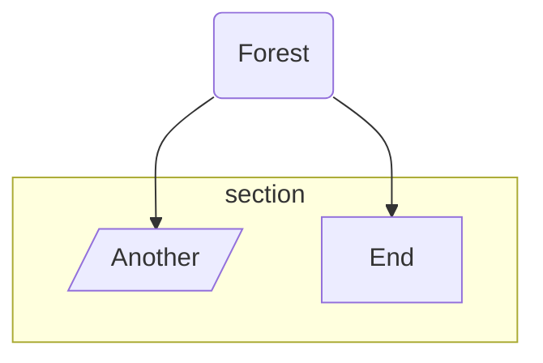
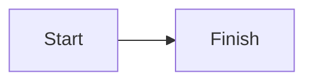

# Reveal.js Slides

Normal docs content here...

## Full Feature Test

<slides>

# Arrays... Your First Chest of Loot

Store items in order, retrieve them by index.

---

## Accessing Items

```js
const loot = ['sword', 'shield', 'potion']
console.log(loot[0]) // 'sword' - zero-indexed!
```

---

## Looping Through Loot

Use a `for...of` loop to grab everything.

Note:
Speaker notes - click the deck, press `s`.

- Mention **zero-indexing** again
- Ask for predictions

---

## Incremental List

+++ list

- **Bold** item one
- Item two with `code`
- Item three

---

## Reveal Steps

Always visible.

+++

### Step One

First paragraph.

+++ fade-up

### Step Two

Second paragraph, with an effect.

---

## Columns

Content before.

|||

### Left column

As nightmarishly lethal, memetically programmed death-machines went...

|||

### Right column

... these were the nicest you could ever hope to meet.

|||

Content after.

---

## Weighted Columns

||| 1fr 2fr

Narrow.

|||

Wide, with steps:

+++

Step A

+++

Step B

|||

---

# Red!
<!-- .slide: data-background="#f003" -->

Testing

---


---




---


---

<speak>


Hello, Human!

</speak>

---

<excalidraw src="_assets/test.excalidraw" alt="Excalidraw test scene">

---

<videoembed id="62xlzGs8LXA">


---

| A   | B   | C     |
| --- | --- | ----- |
| One | Two | Three |

---

<timeline>

- 1967: Steve
- 1978: Jemma
- 2011: Eva Rose
- 2017: Finn Henry

</timeline>


---

```js [0|2-3|5|10|0]
hook.doneEach(function () {
    const placeholders = document.querySelectorAll('.slides-placeholder')
    if (!placeholders.length) return

    placeholders.forEach((placeholder) => {
        const index = placeholder.getAttribute('data-index')
        placeholder.outerHTML = buildRevealHTML(index)
    })

    initDecks()
})
```

</slides>


Back to normal docs...

## Simple Test

<slides>

# Arrays... Your First Chest of Loot

Store items in order, retrieve them by index.

---

# Accessing Items

```js
const loot = ['sword', 'shield', 'potion']
console.log(loot[0]) // 'sword' - zero-indexed!
```

---

# Looping Through Loot

Use a `for...of` loop to grab everything.

</slides>

Back to normal docs...

## Plugins Inside Slides

Page plugins (their markdown and HTML hooks) should work the same inside a deck. Two decks on the page also checks that speaker notes stay with the deck they were opened from.

<slides>

# Plugins Inside Slides

Inline hint: `let coins = 5`(js)

---

## Runnable Python

```python run
print("Hello from a slide")
```

Note:
Speaker notes for the second deck - `s` should open this deck only.

---

## Code Fence With Markers

```md
---
+++
Note:
```

Markers inside a fence stay as code.

---

## Unclosed Single Tag

<convertor>

Content after the tag stays on the slide.

---

## Mermaid



---

## Captioned Image

<captioned>


Hello, human!

</captioned>

---

## Callouts

> [!TIP]
> Callouts are processed by the page's normal doneEach pass.

> [!WARNING]
> This one should have a title and icon too.

---

## Sequence

<sequence direction="horizontal">

1. ## One

2. ## Two

3. ## Three

</sequence>

---

## Hierarchy

<hierarchy>

- Waimea College

    - Staff

        - Teaching
        - Support

    - Students

        - Juniors
        - !! Seniors

</hierarchy>

---

## Structure

<structure>

- Web Server

    - Server Application
    - Programming Language

</structure>

---

## Timeline

<timeline>

- 1967: Steve
- 1978: Jemma
- 2011: Eva Rose

</timeline>

---

## Image Notes


1. Brand area [1.5, 2, 10, 5]

    The **brand block** anchors the page.

2. Add to cart CTA [57, 75, 25, 9]

    The main action.

</img-notes>

---

## Speech

<speak>


Hello from the third deck!

</speak>

---

## Plugins Inside Slides

Same heading text as the page heading above - the sidebar entry must still work.

</slides>

Back to normal docs...
