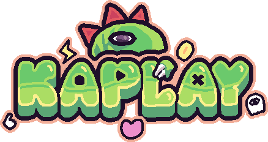

# Make Games with JavaScript and Kaplay

Welcome, game makers! Over the next five weeks you'll learn the **JavaScript** programming language, a game development library called **Kaplay**, and the game-making tools you need to build your own games. Then you'll spend four more weeks designing and building a game of your own.

<menu>

### Week 1: Things That Move

<i data-lucide="move"></i>

[Link](/courses/200dtd/kaplay/week1-intro.md)

Learn the basics of **JavaScript** programming and the **Kaplay** library

Game: **Wander**

---

### Week 2: Clicks, Counts & State

<i data-lucide="mouse-pointer-click"></i>

[Link](/courses/200dtd/kaplay/week2-intro.md)

Notes here

Game: **Whack-a-Bug**

---

### Week 3: Dialogue & Storylines

<i data-lucide="message-circle-text"></i>

[Link](/courses/200dtd/kaplay/week3-intro.md)

Notes here

Game: **The Wizard's Help Desk**

---

### Week 4: Fly, Shoot, Explode

<i data-lucide="rocket"></i>

[Link](/courses/200dtd/kaplay/week4-intro.md)

Notes here

Game: **Space Invaders-ish**

---

### Week 5: Gravity, Physics & Platforms

<i data-lucide="sport-shoe"></i>

[Link](/courses/200dtd/kaplay/week5-intro.md)

Notes here

Game: **Coin Dash**

---

### Project: Design & Create a Game

<i data-lucide="lightbulb"></i>

[Link](/courses/200dtd/kaplay/project-intro.md)

Notes here

Game: **Your Own!**

</menu>

## Useful Links

- [Kaplay Docs](https://v4000.kaplayjs.com/docs/guides/)
- [JavaScript Guide (MDN)](https://developer.mozilla.org/en-US/docs/Web/JavaScript/Guide)
- [JavaScript Tutorial (W3Schools)](https://www.w3schools.com/js/)
- [The Modern JavaScript Tutorial](https://javascript.info/)

## Learning via **PRIMM**

The course uses an approach called **PRIMM**:

| Step            | What you do                                                 |
| --------------- | ----------------------------------------------------------- |
| **P**redict     | Look at some code. Write down what you think it will do.    |
| **R**un         | Run it. Were you right?                                     |
| **I**nvestigate | Work out *why* it did that. Trace it, label it, poke at it. |
| **M**odify      | Change the code and see what happens.                       |
| **M**ake        | Build something new using what you've learned.              |

Getting a prediction wrong is not a failure. It's the best moment for learning, because your brain just found out something it didn't know.

