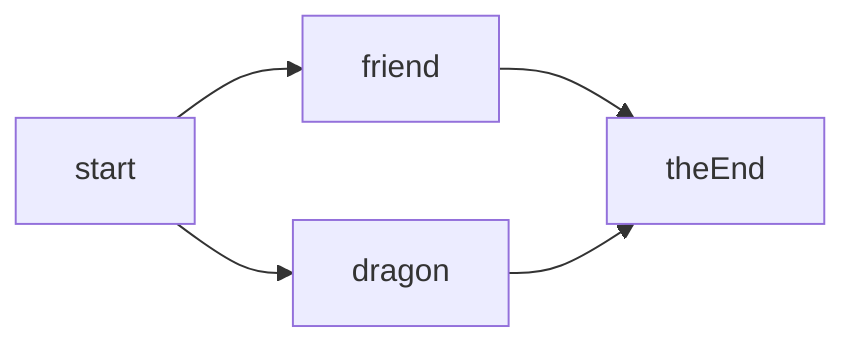

# Lesson 3: Branching Stories

A good story lets the player **choose**. In this lesson you'll store a whole branching story as **data**, show **choices** as buttons, and make the story remember what the player did.

## Warm-Up

Try not to loop back at the previous lessons...

1. What is the difference between a variable declared **inside** a scene and one declared **outside**?

    <response>

2. How do you pass some data to the next scene?

    <response>

3. How many times does this loop run?

    ```js
    for (let i = 0; i < 4; i++) {
        console.log(i)
    }
    ```

    <response>


## Learning Goals

- <check> I can store a story as an **object of nodes**, and look a node up by its **name**
- <check> I can make **choice buttons** from data, using a loop
- <check> I can store a value on a game object, and use it when it's clicked
- <check> I can track **flags** like `trust` and `hasCookie`
- <check> I can use `if` statements to choose between different **endings**


## The Big Idea: **A Story is Data**

We can think of a story as a set of **nodes**. Each node is one moment in the story: someone says something, and then either the story moves **on** to another node, or the player gets some **choices**.



Each node is an **object**. And the whole story is one big object, where each node has a **name** (its key):

```js
const story = {
    start: {
        speaker: "Guard",
        text: "Halt! Who goes there?",
        choices: [
            { label: "A friend!", next: "friend" },
            { label: "A dragon!", next: "dragon" },
        ],
    },
    friend: {
        speaker: "Guard",
        text: "Welcome, friend. Mind the ghosts.",
        next: "theEnd",
    },
}
```

| Property    | What it means                                              |
| ----------- | ---------------------------------------------------------- |
| `speaker`   | Who is talking                                             |
| `text`      | What they say                                              |
| `next`      | The name of the node to go to **next**                     |
| `choices`   | A list of answers: each has a `label` and a `next`         |
| `isEnding`  | Is this the **end** of the story?                          |

### Looking Up a Node

To find a node we use its name. There are two ways to write it:

```js
story.start             // when we know the name when we write the code
story[nodeId]           // when the name is stored in a variable
```

> [!TIP]
> Square brackets let us look up a property using a **variable**. If `nodeId` is `"friend"`, then `story[nodeId]`(js) is the same as `story.friend`(js).


## **P**redict

Look at this Kaplay program. It's the longest one yet, so take your time!

```js
kaplay({
    width: 600, height: 400,
    background: [30, 60, 90]
})

const story = {
    start: {
        speaker: "Guard",
        text: "Halt! Who goes there?",
        choices: [
            { label: "A friend!", next: "friend" },
            { label: "A dragon!", next: "dragon" },
        ],
    },
    friend: {
        speaker: "Guard",
        text: "Welcome, friend. Mind the ghosts.",
        next: "theEnd",
    },
    dragon: {
        speaker: "Guard",
        text: "A dragon? You look like a bean.",
        next: "theEnd",
    },
    theEnd: {
        speaker: "Narrator",
        text: "The End. Press SPACE to play again.",
        isEnding: true,
    },
}

scene("game", () => {
    let currentNode = story.start

    const speakerLabel = add([
        text("", { size: 28 }),
        pos(40, 60),
        color(255, 220, 0),
    ])

    const lineLabel = add([
        text("", { size: 24, width: 520 }),
        pos(40, 110),
    ])

    function showNode(nodeId) {
        currentNode = story[nodeId]

        destroyAll("choiceButton")

        speakerLabel.text = currentNode.speaker
        lineLabel.text = currentNode.text

        if (currentNode.choices) {
            for (let i = 0; i < currentNode.choices.length; i++) {
                const choice = currentNode.choices[i]

                const button = add([
                    rect(300, 40, { radius: 8 }),
                    pos(40, 230 + i * 50),
                    color(60, 90, 140),
                    area(),
                    "choiceButton",
                    { goTo: choice.next },
                ])

                button.add([
                    text(choice.label, { size: 20 }),
                    pos(14, 9),
                ])
            }
        }
    }

    onClick("choiceButton", (button) => {
        showNode(button.goTo)
    })

    onKeyPress("space", () => {
        if (currentNode.choices) {
            return
        }

        if (currentNode.isEnding) {
            go("game")
            return
        }

        showNode(currentNode.next)
    })

    showNode("start")
})

go("game")
```

What does the screen show when the game **starts**?

<response>

What happens when you click **"A dragon!"**, and then press SPACE?

<response>

What happens if you press SPACE while the choices are showing? Which line of code decides this?

<response>


## **R**un

<web-playground hidden>

```html id=kaplay load=_assets/kaplay.html
```

```css id=kaplay load=_assets/kaplay.css
```
</web-playground>

Run the game and try both paths. Compare it with your predictions - any differences?

<web-playground data-height="32em" js-only>

```html depends=kaplay
```

```css depends=kaplay
```

```js
kaplay({
    width: 600, height: 400,
    background: [30, 60, 90]
})

const story = {
    start: {
        speaker: "Guard",
        text: "Halt! Who goes there?",
        choices: [
            { label: "A friend!", next: "friend" },
            { label: "A dragon!", next: "dragon" },
        ],
    },
    friend: {
        speaker: "Guard",
        text: "Welcome, friend. Mind the ghosts.",
        next: "theEnd",
    },
    dragon: {
        speaker: "Guard",
        text: "A dragon? You look like a bean.",
        next: "theEnd",
    },
    theEnd: {
        speaker: "Narrator",
        text: "The End. Press SPACE to play again.",
        isEnding: true,
    },
}

scene("game", () => {
    let currentNode = story.start

    const speakerLabel = add([
        text("", { size: 28 }),
        pos(40, 60),
        color(255, 220, 0),
    ])

    const lineLabel = add([
        text("", { size: 24, width: 520 }),
        pos(40, 110),
    ])

    function showNode(nodeId) {
        currentNode = story[nodeId]

        destroyAll("choiceButton")

        speakerLabel.text = currentNode.speaker
        lineLabel.text = currentNode.text

        if (currentNode.choices) {
            for (let i = 0; i < currentNode.choices.length; i++) {
                const choice = currentNode.choices[i]

                const button = add([
                    rect(300, 40, { radius: 8 }),
                    pos(40, 230 + i * 50),
                    color(60, 90, 140),
                    area(),
                    "choiceButton",
                    { goTo: choice.next },
                ])

                button.add([
                    text(choice.label, { size: 20 }),
                    pos(14, 9),
                ])
            }
        }
    }

    onClick("choiceButton", (button) => {
        showNode(button.goTo)
    })

    onKeyPress("space", () => {
        if (currentNode.choices) {
            return
        }

        if (currentNode.isEnding) {
            go("game")
            return
        }

        showNode(currentNode.next)
    })

    showNode("start")
})

go("game")
```

</web-playground>


## **I**nvestigate

### The Nodes

Look at the four nodes in the story. Tick the properties that **each node has**:

| Node       | `speaker` | `text`  | `next`  | `choices` | `isEnding` |
| ---------- | --------- | ------- | ------- | --------- | ---------- |
| `start`    | <check>   | <check> | <check> | <check>   | <check>    |
| `friend`   | <check>   | <check> | <check> | <check>   | <check>    |
| `dragon`   | <check>   | <check> | <check> | <check>   | <check>    |
| `theEnd`   | <check>   | <check> | <check> | <check>   | <check>    |

### Looking Up

1. What's the difference between `story.start`(js) and `story[nodeId]`(js)? When do we need each one?

    <response>

2. If `nodeId` is `"dragon"`, what does `story[nodeId].text`(js) give us?

    <response>

### Buttons from Data

1. How many buttons are made for the `start` node? What is `i` on each lap of the loop?

    <response>

2. What does `230 + i * 50`(js) do? Why is it needed?

    <response>

3. Each button is given `{ goTo: choice.next }`(js). What is that for? How does the `onClick`(js) function use it?

    <response>

4. What does `destroyAll("choiceButton")`(js) do, and why is it at the top of `showNode`?

    <response>

### Remembering Choices

A good story **remembers** what the player did. We'll use two pieces of state, like the ones in our final game:

- `trust`: a **number**. Kind choices add to it, rude ones take away
- `hasCookie`: a **boolean**. Did the player get the browser cookie?

Step through this code, which pretends the player has visited four nodes:

```js trace header="false"
let trust = 0
let hasCookie = false

trust = trust + 1
hasCookie = true
trust = trust - 1
trust = trust + 1

console.log(`trust: ${trust}, hasCookie: ${hasCookie}`)
console.log(hasCookie && trust >= 1)
```

<response placeholder="Observations...">

### Choosing an Ending

The ending depends on the state. The **most specific** rule has to be checked **first**. Put the lines in order:

- **Good ending** if the player has the cookie **and** `trust` is at least 1
- **Okay ending** if `trust` is at least 1
- **Bad ending** otherwise

<drag-drop mode="code" title="Pick an Ending" sub-title="Check the most specific rule first">

1.
    ```js
    if (hasCookie && trust >= 1) {
        return "homeGood"
    }
    ```

2.
    ```js
    if (trust >= 1) {
        return "homeOkay"
    }
    ```

3.
    ```js
    return "homeBad"
    ```

</drag-drop>

> [!NOTE]
> A `return`(js) inside a function stops the function straight away and hands a value back. That's why we don't need `else` here.

### Matching

Match each property to what it does in the final game.

<drag-drop mode="code" title="What Does It Do?" sub-title="">

1.
    ```js
    choices: [ ... ]
    ```

2.
    ```js
    next: "problem"
    ```

3.
    ```js
    trust: 1
    ```

4.
    ```js
    cookie: true
    ```

5.
    ```js
    isEnding: true
    ```

---

1. Show some buttons for the player to pick from
2. Carry on to another node when SPACE is pressed
3. Add one to the trust score when the node is shown
4. Give the player the browser cookie when the node is shown
5. Go to the ending scene when SPACE is pressed

</drag-drop>


## **M**odify

### Bug Hunt

This version of the story has some bugs. Play it, and check the **Console** if something goes wrong. Can you fix the following?

<web-playground data-height="32em" js-only>

```html depends=kaplay
```

```css depends=kaplay
```

```js
kaplay({
    width: 600, height: 400,
    background: [30, 60, 90]
})

const story = {
    start: {
        speaker: "Guard",
        text: "Halt! Who goes there?",
        choices: [
            { label: "A friend!", next: "friend" },
            { label: "A dragon!", next: "dragon" },
        ],
    },
    friend: {
        speaker: "Guard",
        text: "Welcome, friend. Mind the ghosts.",
        next: "theEnd",
    },
    dragon: {
        speaker: "Guard",
        text: "A dragon? You look like a bean.",
        next: "theEnd",
    },
    theEnd: {
        speaker: "Narrator",
        text: "The End. Press SPACE to play again.",
        isEnding: true,
    },
}

scene("game", () => {
    let currentNode = story.start

    const speakerLabel = add([
        text("", { size: 28 }),
        pos(40, 60),
        color(255, 220, 0),
    ])

    const lineLabel = add([
        text("", { size: 24, width: 520 }),
        pos(40, 110),
    ])

    function showNode(nodeId) {
        currentNode = story[nodeId]

        speakerLabel.text = currentNode.speaker
        lineLabel.text = currentNode.text

        if (currentNode.choices) {
            for (let i = 0; i < currentNode.choices.length; i++) {
                const choice = currentNode.choices[i]

                const button = add([
                    rect(300, 40, { radius: 8 }),
                    pos(40, 230 + i * 50),
                    color(60, 90, 140),
                    "choiceButton",
                    { goTo: choice.next },
                ])

                button.add([
                    text(choice.label, { size: 20 }),
                    pos(14, 9),
                ])
            }
        }
    }

    onClick("choiceButton", (button) => {
        showNode(button.next)
    })

    onKeyPress("space", () => {
        if (currentNode.choices) {
            return
        }

        if (currentNode.isEnding) {
            go("game")
            return
        }

        showNode(currentNode.next)
    })

    showNode("start")
})

go("game")
```

</web-playground>

1. <check> Clicking a choice button **does nothing**
2. <check> Once clicking works, the game **crashes** with an error about `undefined`
3. <check> After picking a choice, the **old buttons are still there**

> [!TIP]
> Fix them one at a time, in order. Each fix will reveal the next bug!

### Tinker

Using the working story from the **Run** step above, complete the tasks one at a time:

1. <check> Add a **third choice** to the `start` node, `"A pizza delivery!"`, and a new node for it to go to
2. <check> Add a `let trust = 0`(js) variable (**inside** the scene!). Give some nodes a `trust` property, and add it to `trust` whenever `showNode`(js) shows that node
3. <check> On the **ending** node, show the player's `trust` as well as the text (hint: a template literal, in `showNode`(js))

> [!TIP]
> To add a node's `trust` to the total, put this in `showNode`:
>
> ```js
> if (currentNode.trust) {
>     trust = trust + currentNode.trust
> }
> ```
>
> A node with no `trust` property gives `undefined`, which counts as **false**, so the `if` is skipped.


## **M**ake

### Help Desk Story

Write your own branching story, set at the **Wizard's Help Desk**. A customer arrives with a magical computer problem: a haunted printer, a cursed WiFi router, a spellchecker that casts spells... you decide!

> [!IMPORTANT]
> **Plan first!** Draw a **story map** on paper: a box for each node, and arrows showing where each choice leads. Mark where `trust` goes up or down.

Your story must have:

- <check> At least **8 nodes**
- <check> At least **two** places where the player makes a **choice**
- <check> A `trust` score (or a flag like `hasCookie`) that **changes** as the story goes
- <check> At least **three different endings**, chosen using `if` statements

<web-playground data-height="32em" js-only>

```html depends=kaplay
```

```css depends=kaplay
```

```js
// Copy the working story code from above here, then write your own story!
```

</web-playground>

### Level Up

Finished early? Try these. Pick the ones that sound fun.

| Challenge                                                   | Hint                                                                   |
| ----------------------------------------------------------- | ---------------------------------------------------------------------- |
| Show the **trust score** on screen as the story goes        | A new label, updated in `showNode`(js)                                 |
| Add a **secret ending** for a very specific set of choices  | Check several flags with `&&`(js)                                      |
| Count the **number of choices** the player has made         | A new `let`(js) variable, and add 1 when a button is clicked           |


## Exit Ticket

Without looking back, answer these three questions:

<quiz>

- # If `nodeId` is `"friend"`, which of these is the same as `story[nodeId]`?

    ---

    - [ ] `story.nodeId`
    - [x] `story.friend`
    - [ ] `friend.story`
    - [ ] `story["nodeId"]`

- # What does `destroyAll("choiceButton")` do?

    ---

    - [ ] Destroys the story
    - [ ] Destroys the game
    - [x] Removes every object tagged `"choiceButton"` from the screen
    - [ ] Stops the buttons being clicked

- # `hasCookie` is `true` and `trust` is `0`. What does `hasCookie && trust >= 1` give?

    ---

    - [ ] `true`
    - [x] `false`
    - [ ] `0`
    - [ ] `undefined`

</quiz>
