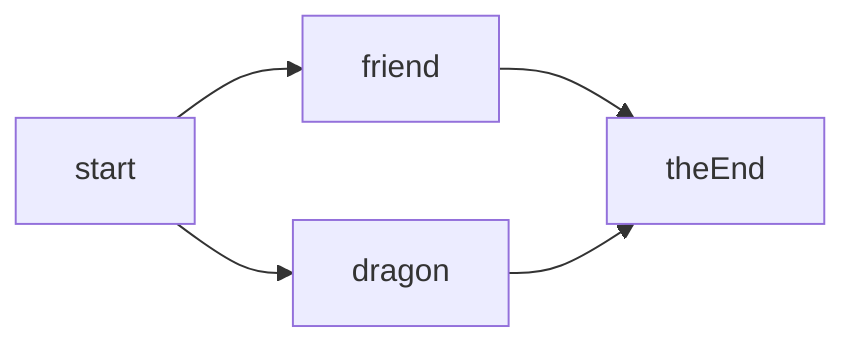

# Week 3: Dialogue & Storylines


## Lesson 1: Lists & Objects

<slides>

# Lesson 1: Lists & Objects

Note:
Week 3 is about stories. A story is lots of text, so we need ways to store lots of data. Arrays and objects are the tools

---

## Learning

- Storing lists in **arrays**
- Getting items by **index**
- Grouping values into **objects**
- Storing a conversation as an **array of objects**
- Stepping through it with an **index variable**

---

## Arrays

```js
const colours = ["red", "green", "blue"]

console.log(colours[0])       // "red"
console.log(colours.length)   // 3
```

| Index | 0     | 1       | 2      |
| ----- | ----- | ------- | ------ |
| Item  | `"red"` | `"green"` | `"blue"` |

Indexes start at **0**!

Note:
- Last index is always length - 1
- Ask: what does colours[3] give? (undefined)

---

## Objects

```js
const wizard = {
    name: "Shroomwick",
    level: 12,
    isWise: true,
}

console.log(wizard.name)
```

A bundle of **named** values

Note:
- Not the same as a Kaplay game object. It's just a card with labelled fields
- Link back to `text("Hi", { size: 28 })`: they've already been using objects

---

## Both Together

```js
const dialogue = [
    { speaker: "Wizard", text: "Welcome!" },
    { speaker: "You", text: "Hello!" },
]

console.log(dialogue[1].speaker)
```

A list of lines, each line an object

---

## Dialogue State

```js
let lineIndex = 0

onKeyPress("space", () => {
    if (lineIndex < dialogue.length - 1) {
        lineIndex = lineIndex + 1
        showLine()
    }
})
```

`lineIndex` is **game state**

Note:
- Why length - 1? Go past the end and you get undefined, then a crash
- Why a showLine() function? Used in two places

---

## Make: Talk to the Wizard

- At least **6 lines** of dialogue
- At least **two speakers**
- SPACE advances, and **stops** at the end
- Each speaker in a **different colour**

</slides>


## Lesson 2: Scenes

<slides>

# Lesson 2: Scenes

Note:
Real games have a title screen, the game itself, an ending. Scenes let us build each as a separate screen

---

## Learning

- Defining scenes with `scene(...)`
- Switching with `go(...)`
- **Passing data** between scenes
- Where **variables live**

---

## Scenes

```js
scene("title", () => {
    // objects and events for the title screen
})

go("title")
```

A scene is **one screen** of your game

Note:
A scene doesn't start until you go() to it. Always finish with a go() to the first scene

---

## Switching

```js
onKeyPress("space", () => {
    go("talk")
})
```

Kaplay **throws away** everything from the old scene

Note:
Objects, event handlers and timers all disappear. The new scene runs from the top

---

## Passing Data

```js
go("ending", { lines: 5 })

scene("ending", (data) => {
    // data.lines is 5
})
```

Data goes in an **object**

---

## Where Variables Live

```js
scene("talk", () => {
    let lineIndex = 0   // fresh each visit
})
```

**Inside** a scene: created **again** every time

**Outside** all scenes: created **once**, kept for good

Note:
This is the big idea of the lesson. Predict step: where does the conversation start when you play again?

---

## Make: Three-Scene Story

- **Title** scene
- **Talk** scene (6+ lines)
- **Ending** scene that shows something the talk scene told it
- Playing again starts at the **first line**

</slides>


## Lesson 3: Branching Stories

<slides>

# Lesson 3: Branching Stories

Note:
A good story lets the player choose, and remembers what they did

---

## Learning

- A story as an **object of nodes**
- **Choice buttons** made from data
- **Flags** like `trust` and `hasCookie`
- Choosing between **endings** with `if`

---

## Story Nodes



Each node is an **object**. The whole story is an object of nodes

---

## A Node

```js
start: {
    speaker: "Guard",
    text: "Halt! Who goes there?",
    choices: [
        { label: "A friend!", next: "friend" },
        { label: "A dragon!", next: "dragon" },
    ],
},
```

`next`, `choices` or `isEnding`

Note:
Walk through each property. A node either carries on (next), asks a question (choices) or ends the story

---

## Looking Up Nodes

```js
story.start         // name known when writing the code
story[nodeId]       // name stored in a variable
```

Square brackets look up a property using a **variable**

---

## Buttons from Data

```js
for (let i = 0; i < node.choices.length; i++) {
    const choice = node.choices[i]

    add([
        rect(300, 40),
        pos(40, 230 + i * 50),
        area(),
        "choiceButton",
        { goTo: choice.next },
    ])
}
```

One button per choice, each remembering where it leads

Note:
- A plain object in the component list adds a custom property to the game object
- destroyAll("choiceButton") clears the old buttons first

---

## Flags and Endings

```js
function pickEnding() {
    if (hasCookie && trust >= 1) {
        return "homeGood"
    }
    if (trust >= 1) {
        return "homeOkay"
    }
    return "homeBad"
}
```

Most **specific** rule first!

---

## Make: Help Desk Story

- **8+ nodes**
- **Two** places with a choice
- A `trust` score or flag that **changes**
- **Three** different endings

*Plan a story map on paper first!*

</slides>


## Lesson 4: The Wizard's Help Desk

<slides>

# Lesson 4: The Wizard's Help Desk

Note:
Build day. Students port their story into the modular skeleton and add typewriter text and portraits

---

## Learning

- Splitting a game into **files**
- `import` and `export`
- The **typewriter** effect
- **Portraits** for each speaker

---

## The Files

- `main.js`: starts Kaplay, registers scenes
- `data/story.js`: the story
- `scenes/title.js`
- `scenes/talk.js`
- `scenes/ending.js`

Note:
Separate the data from the code. Each scene gets its own file

---

## Import and Export

```js
// data/story.js
export const story = { ... }

// scenes/talk.js
import { story } from "../data/story.js"
```

`./` this folder, `../` up one folder

Note:
- Needs type="module" in index.html and a local server
- scene("talk", talkScene): no brackets! We hand over the function

---

## The Typewriter

```js
loop(0.03, () => {
    if (charCount < fullText.length) {
        charCount = charCount + 1
        lineLabel.text = fullText.slice(0, charCount)
    }
})
```

One loop per scene, state in `fullText` and `charCount`

Note:
Why only one loop? Every extra loop would make the text type faster

---

## Portraits

```js
const portraits = {
    Wizard: "mushroom",
    Ghost: "ghost",
}

sprite(portraits[currentNode.speaker])
```

An object as a **look-up**

---

## Build Steps

1. Explore the skeleton
2. Write your story
3. Trust and endings
4. Typewriter
5. Portraits
6. Title and ending

*Test after every step!*

Note:
Finish with playtesting and the Week 3 Check quiz

</slides>
